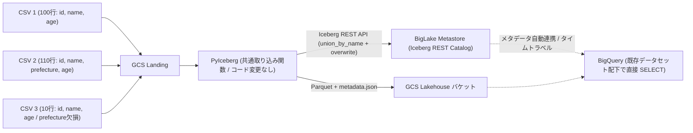

# GCP 実機ハンズオン: PyIceberg × BigLake Metastore × BigQuery 自動スキーマ進化 & Upsert

Google Cloud（GCS / BigLake Metastore / BigQuery）と PyIceberg を使い、Apache Iceberg の自動スキーマ進化（Schema Evolution）と Upsert を実機で体験するための実践ハンズオンです。

## シナリオ概要

1. **1回目のデータ連携**: `id, name, age` の 3 カラム・100 行の CSV を GCS に配置し、PyIceberg で Lakehouse 用バケットへ Apache Iceberg テーブルとして出力 → BigQuery からそのまま参照（100 行・3 カラム）。
2. **2回目のデータ連携（列の途中追加＋Upsert）**: 既存 100 行（同じ ID）＋新規 10 行の計 110 行で、**3 列目に `prefecture` が割り込み追加された CSV（`id, name, prefecture, age`）** を GCS に配置し、コード変更なしで実行 → BigQuery 側も `ALTER TABLE` なしで 110 行・4 カラムとして参照。
3. **3回目のデータ連携（列欠損データのロード）**: `prefecture` カラムが欠損した追加 10 行（`id = 111..120`、`id, name, age`）を同じ関数でロード → テーブルから `prefecture` 列は削除されず、欠損列が `NULL` としてロードされることを確認（計 120 行）。
4. **タイムトラベル検証**: BigQuery の `FOR SYSTEM_TIME AS OF` を使い、1 回目（100 行・3 列）・2 回目（110 行・4 列）・3 回目（120 行・4 列）の各ロード時点の断面を SQL で再現・比較します。

## アーキテクチャ



## 事前準備

### 1. Python 依存関係の同期

```bash
uv sync
```

### 2. 環境変数ファイル（`.env`）の作成

プロジェクト ID やバケット名は Git 管理対象外の `.env` ファイルで管理します。テンプレートをコピーしてご自身の環境に合わせて編集してください。

```bash
cp .env.example .env
# .env 内の GCP_PROJECT_ID / GCS_LANDING_BUCKET / GCS_LAKEHOUSE_BUCKET / BQ_DATASET を編集
```

シェルコマンドから同じ環境変数を参照する場合は、以下で読み込みます。

```bash
set -a && source .env && set +a
```

### 3. Google Cloud 認証（ADC）と API 有効化

```bash
# ローカルから Python (PyIceberg / GCS / BigQuery) が認証できるよう ADC を設定
gcloud auth application-default login

# BigLake / Storage / BigQuery API を有効化
gcloud services enable biglake.googleapis.com storage.googleapis.com bigquery.googleapis.com \
  --project="$GCP_PROJECT_ID"
```

※ `warehouse` に `bq://projects/$GCP_PROJECT_ID` を指定するため、既存の BigQuery データセット（`BQ_DATASET`）をそのまま Namespace として利用でき、別途 BigLake カタログを作成する手順は不要です。

## ハンズオンの実行

JupyterLab を起動し、[01_gcp_pyiceberg_biglake_schema_evolution.ipynb](../../notebooks/01_gcp_pyiceberg_biglake_schema_evolution.ipynb) を上から順に実行します。

```bash
uv run jupyter lab
```

## 技術的なポイント

- **なぜ 3 列目へのカラム割り込みでも壊れないのか？**
  - Iceberg は列の位置（0 番目、1 番目…）ではなく不変の `field-id`（`1: id`, `2: name`, `3: age`, `4: prefecture`）で列を管理します。
  - `table.update_schema().union_by_name(incoming.schema)` で新カラム `prefecture` に新しい `field-id=4` を自動採番し、入力 CSV を名前ベースで整列して書き込むことで、既存の `age`（`field-id=3`）と混同せずに安全に進化します。
- **なぜ BigQuery 側で `ALTER TABLE` や外部テーブル再作成が不要なのか？**
  - BigLake Metastore（Iceberg REST Catalog、`warehouse=bq://projects/<PROJECT_ID>`）を使うと、既存の BigQuery データセット内に Iceberg テーブルが直接登録され、通常の 3 パート名（`` `project.dataset.table` ``）で最新のメタデータを参照できます。PyIceberg によるスキーマ進化や新スナップショットのコミットがそのまま BigQuery に自動反映されます。
- **なぜ `table.upsert()` ではなく `table.overwrite(aligned, overwrite_filter=In("id", keys))` を使っているのか？**
  - PyIceberg の `table.upsert()` は内部で既存データファイルの Arrow バッチと新データを列比較する際、直前に追加されたばかりで旧 Parquet に存在しない列がある場合に `Target schema's field names are not matching` エラーとなる既知の制約があります。
  - `overwrite(aligned, overwrite_filter=In("id", keys))` を使うことで、スキーマ進化直後でも同一 ID の置換＋新規 ID の追加を 1 スナップショットでアトミックに実行できます。

## 後片付け（任意）

ハンズオンで作成したテスト用テーブルや CSV ファイルを削除したい場合は、以下を実行してください。

```bash
# GCS 上のランディング CSV を削除
gcloud storage rm -r "gs://${GCS_LANDING_BUCKET}/${GCS_LANDING_PREFIX}/"
```

（※ テーブル自体の削除はノートブック内の `catalog.drop_table("iceberg_handson.users_master")` でも実行できます。）
