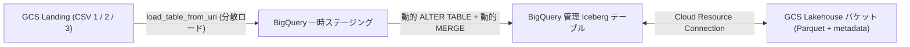

# GCP 実機ハンズオン 02: BigQuery 管理 Iceberg テーブルによる分散ロード・自動スキーマ進化・MERGE

ハンズオン 01（PyIceberg によるシングルノード処理）に対して、**CSV の読み込み・スキーマ進化・Upsert（`MERGE`）までをすべて BigQuery の分散エンジンに任せる**パターンを実機で体験するハンズオンです。

## シナリオ概要

データ量は 01 と同じ 100〜120 行に抑え、コストを無料枠内（実質 0 円）にしたまま以下の流れを検証します。

1. **1回目の連携**: `id, name, age`（100 行）を BigQuery 側で分散ロードし、GCS に実体を持つ BigQuery 管理 Iceberg テーブルを作成。
2. **2回目の連携（列の途中追加＋Upsert）**: 3 列目に `prefecture` が挿入された 110 行 CSV をコード変更なしで投入 → 動的 `ALTER TABLE` ＋ 動的 `MERGE` で自動スキーマ進化と Upsert を実行。
3. **3回目の連携（列欠損データのロード）**: `prefecture` が欠損した追加 10 行（`id = 111..120`）を同じ関数で投入 → カラムを削除せず `NULL` 補完してロード（計 120 行）。
4. **タイムトラベル検証**: BigQuery の `FOR SYSTEM_TIME AS OF` を使い、1〜3 回目の各断面を `SELECT *` で再現・比較。

## アーキテクチャ



## 事前準備

### 1. 環境変数ファイル（`.env`）の確認

`.env` に `BQ_CONNECTION_ID` が設定されていることを確認します（未作成の場合は `.env.example` からコピー）。

```bash
cp .env.example .env
set -a && source .env && set +a
```

### 2. BigQuery Cloud Resource 接続の作成と GCS 権限付与（初回のみ・無料）

BigQuery が GCS の Lakehouse バケットへ Parquet と Iceberg メタデータを書き込むための接続を作成し、そのサービスアカウントへ権限を付与します。

```bash
# Cloud Resource 接続を作成
bq mk --connection \
  --location="$GCP_LOCATION" \
  --project_id="$GCP_PROJECT_ID" \
  --connection_type=CLOUD_RESOURCE \
  "$BQ_CONNECTION_ID"

# 接続のサービスアカウントを取得
CONN_SA=$(bq show --connection --format=json \
  "${GCP_PROJECT_ID}.${GCP_LOCATION}.${BQ_CONNECTION_ID}" \
  | python3 -c "import sys, json; print(json.load(sys.stdin)['cloudResource']['serviceAccountId'])")

# Lakehouse バケットへの書き込み権限を付与（IAM 反映に 10〜20 秒ほどかかります）
gcloud storage buckets add-iam-policy-binding "gs://${GCS_LAKEHOUSE_BUCKET}" \
  --member="serviceAccount:${CONN_SA}" \
  --role="roles/storage.objectAdmin" \
  --project="$GCP_PROJECT_ID"
```

## ハンズオンの実行

JupyterLab を起動し、[02_gcp_bigquery_managed_iceberg_schema_evolution.ipynb](../../notebooks/02_gcp_bigquery_managed_iceberg_schema_evolution.ipynb) を上から順に実行します。

```bash
uv run jupyter lab
```

## 後片付け（任意）

```bash
bq rm -f -t "${GCP_PROJECT_ID}:${BQ_DATASET}.${BQ_MANAGED_TABLE_NAME}"
gcloud storage rm -r "gs://${GCS_LAKEHOUSE_BUCKET}/${BQ_DATASET}/${BQ_MANAGED_TABLE_NAME}/"
```
